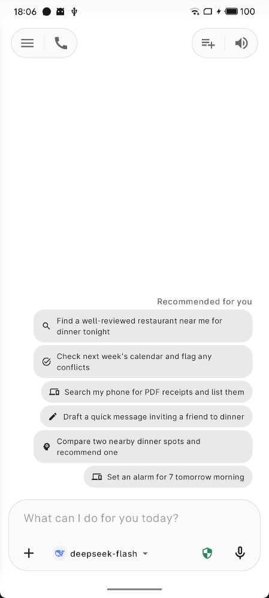
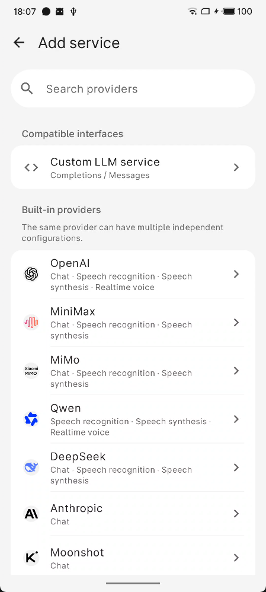
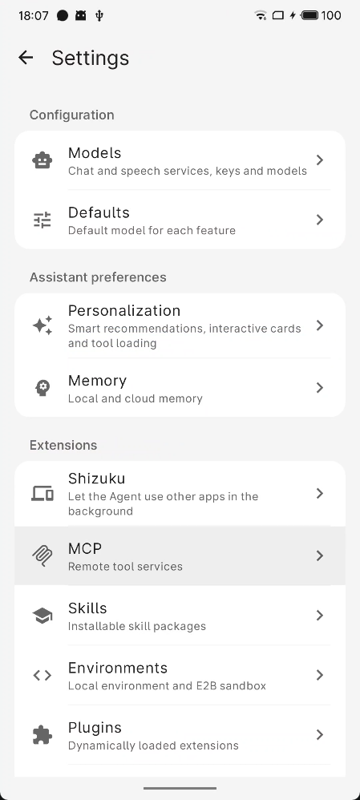
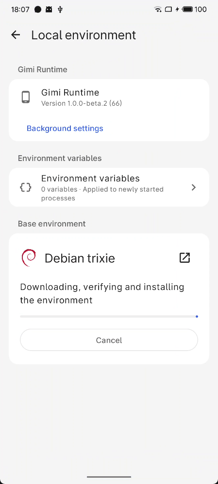
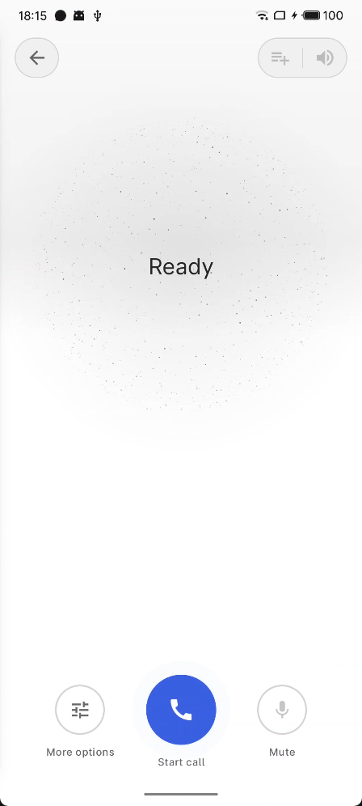
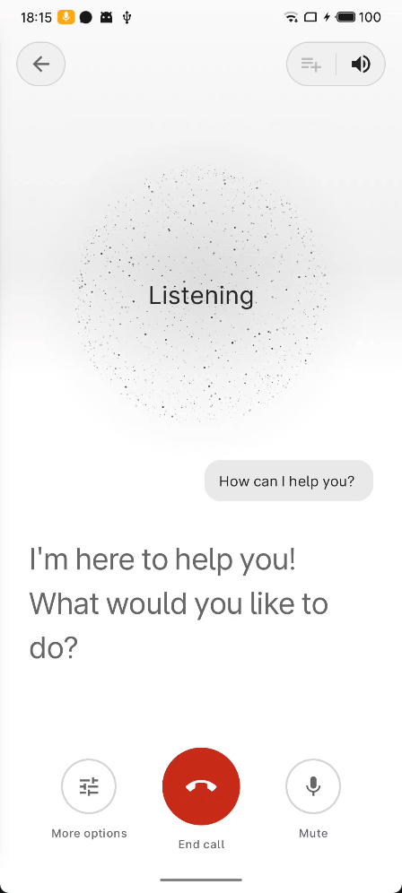
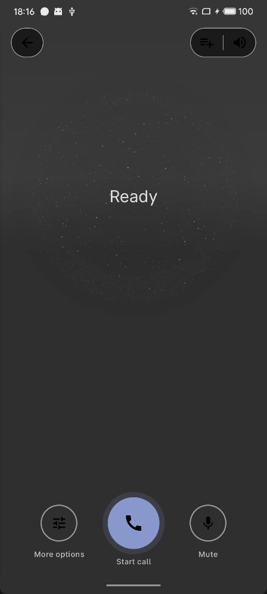
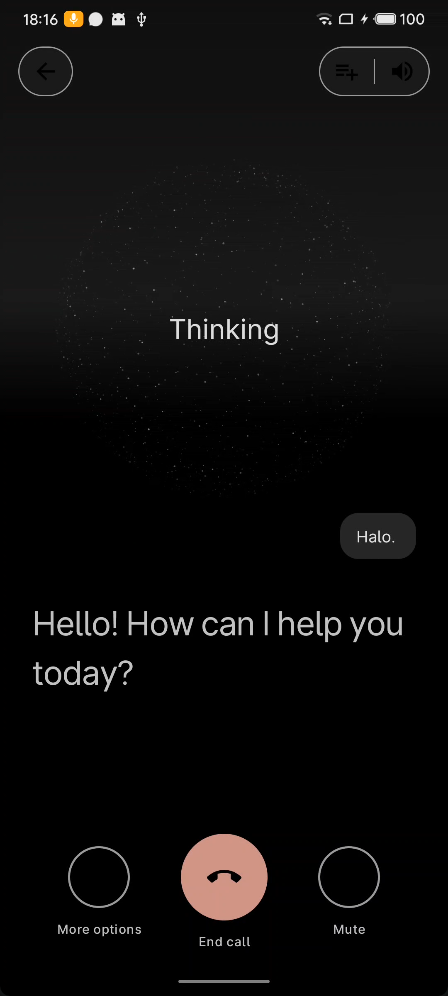

<picture>
  <source media="(prefers-color-scheme: dark)" srcset="doc/icon-dark.png" />
  
</picture>

# Gimi

**An Android AI assistant with your own API keys, phone tools, and extensible agents.**

Built as a fully native Android app with Jetpack Compose.

[English](README.md) · [简体中文](README.zh-CN.md)

## Features

- **Chat and voice**: streaming replies, image/document/audio attachments where supported, speech input and reply playback, and native A2UI interactive cards. Voice calls offer four modes with automatic turn detection and interruption; the Realtime assistant mode can also use authorized tools during the call.
- **Phone tools**: calendars, alarms, media, volume, brightness, location, contacts, apps, and local file search and reading.
- **Background tasks**: continue conversations in the background, with notifications for approvals, input requests, and completion.
- **Personalization**: per-conversation models and tools, task suggestions, on-device memory, and optional Mem0 memory.
- **Local workspace**: store and manage attachments on the device; export conversations as JSONL or ZIP.
- **Extensions**: official provider tools, MCP servers, remote A2A agents, APK plugins, skills, AppFunctions, Shizuku, a local Debian runtime environment, and an E2B cloud sandbox.

<table>
<tr>
<td> Chat</td>
<td> Add service</td>
<td> Settings</td>
<td> Local environment</td>
</tr>
<tr>
<td> Voice call</td>
<td> Voice call with captions</td>
<td> Voice call, dark mode</td>
<td> Realtime assistant, dark mode</td>
</tr>
</table>

## Getting started

Requires **Android 14+** and your own model API key.

1. Download a matching app APK from [Releases](https://github.com/pony-huang/Gimi/releases/latest).
2. In **Settings → Models**, add a built-in provider or a compatible endpoint, then configure its chat connection with your API key and models, test the connection, and enable the service.
3. In **Settings → Defaults**, select a chat model and a quick model for titles and suggestions.
4. Grant permissions as needed and start chatting. Manage suggestions, A2UI cards, and tool loading in **Settings → Personalization**.

For voice, configure recognition, synthesis, and Realtime connections in a service's details under **Settings → Models**, and pick a Realtime model and voice in **Settings → Defaults** before using the Realtime modes. The voice page's **Chat modes** panel offers *Quick chat* (no saved history), *Assistant* (full agent with tools, saved to the conversation), *Realtime* (native full-duplex audio), and *Realtime assistant* (Realtime plus authorized phone, MCP, plugin, AppFunctions, and local-environment or E2B sandbox tools during the call). Realtime calls are not written to the conversation history.

The global permission mode is available in the composer's **Add to chat** panel: *request approval* pauses sensitive tool calls for confirmation; *full approval* allows them automatically.

## Models and official tools

Presets:  **OpenAI** ·  **Anthropic** ·  **DeepSeek** ·  **Kimi** ·  **GLM** ·  **MiniMax** ·  **MiMo** ·  **Qwen**

Each built-in provider covers one or more service connections — chat, recognition, synthesis, or realtime — and the same provider can be added more than once with independent credentials and models; Qwen is a voice-only preset.

Gimi supports **Completions** (OpenAI Chat Completions) and **Messages** (Anthropic) endpoints. Attachment, reasoning, and tool capabilities depend on the selected model and protocol.

Voice capabilities are configured as connections of a model service: Qwen (Alibaba Cloud Bailian), OpenAI, MiniMax, MiMo, and DeepSeek (through dedicated `/v1/tools/asr` and `/v1/tools/tts` endpoints) provide recognition and synthesis; Kimi and GLM can also serve synthesis and audio understanding over the OpenAI-compatible audio channel. OpenAI Realtime and Qwen-Audio Realtime power the native full-duplex Realtime modes.

Qwen (Alibaba Cloud Bailian, reached through the DashScope platform) covers the whole voice path. Its `qwen-audio` models offer streaming recognition, whole-utterance transcription, and `flash`/`plus` synthesis, with each generation and tier shipping its own voice set covering Mandarin, dialect, and multilingual voices. The `qwen-audio` Realtime models open a native full-duplex WebSocket session in which the server detects turns and handles interruption; their session voice is chosen in **Settings → Defaults** and is separate from the synthesis voices. Qwen Realtime also accepts function calls, so the Realtime assistant mode can use authorized tools during a Qwen call.

Enable official tools under **Provider tools** in a model service's details (**Settings → Models**), then select them in the conversation:

| Provider | Official tools |
|---|---|
| DeepSeek | Web search and fetch |
| Anthropic | Web search |
| MiniMax | Web search, text-to-image, reference-image generation |
| GLM | Web search and webpage reading |
| Kimi | Search Basic / Pro and web fetch |

**Why no Gemini on mobile?** Gimi does not currently support Gemini on phones. The [Google Gen AI Kotlin SDK](https://github.com/googleapis/kotlin-genai#readme) supports Android, but its security guidance discourages embedding API keys or Google Cloud credentials in public mobile clients and recommends [Firebase AI Logic with App Check](https://firebase.google.com/docs/ai-logic) or a secure backend. Gimi has not adopted either architecture.

## Extensions

Configure optional capabilities in Settings:

| Extension | Purpose and requirements |
|---|---|
| **MCP** | Remote tools over Streamable HTTP; import `mcpServers` JSON or curl snippets. Supports bearer tokens and custom headers. |
| **A2A** | Delegate tasks to remote agents using an Agent URL and optional bearer token. |
| **Plugins** | Install separate APKs from Releases or the in-app subscription catalog; downloads are SHA-256 verified. |
| **Skills** | Install instructions and resources from a URL or local ZIP; run scripts in the local Debian environment or the E2B sandbox. |
| **Local environment** | Under **Settings → Environments**, the bundled Gimi Runtime companion APK runs a local Debian (trixie) environment under a separate UID. Install or update the runtime component, edit environment variables, browse the local directory tree, and let the agent run shell commands, Python/JavaScript, and background jobs. |
| **E2B sandbox** | Configure an E2B API key for shell commands, Python/JavaScript, and files in an isolated cloud environment per conversation. |
| **AppFunctions** | Discover other apps' functions on supported Android 16+ devices; execution requires privileged system access. See the [execution guide](spec/en/appfunctions.md). |
| **Shizuku** | Configure it from **Settings → Shizuku**. Background app control requires Shizuku in ADB shell mode, an image-capable model, and overlay permission; text input and native element actions also need the Gimi Accessibility service. |

Available plugins:

| Plugin | Capabilities |
|---|---|
| Spotify | Search, playback, playlists, and library |
| Zhihu | Search, hot lists, synthesized answers, knowledge bases, and document tasks |
| V2EX | Nodes, topics, replies, notifications, and account information |
| Weibo | Trending searches, AI summaries, Super Topics, posts, and comments |
| Xiaohongshu | Sign-in, feeds, search, interactions, and image/video publishing through an on-device WebView |
| NetEase Cloud Music | Sign-in, search, lyrics, playlists, and authorized audio URLs; no playback control |

Some plugins require their own platform credentials and authorization. Third-party plugins can use the public [plugin API](plugin-api/).

## Privacy and permissions

Conversations, attachments, and settings are stored on the device. The developer operates no servers and collects no analytics or telemetry. Relevant content is sent to the model and other services you configure or enable; these services follow their own privacy policies.

Grant system permissions as needed and revoke them in Android settings. Document search across shared storage requires all-files access. See the [Privacy Policy](https://github.com/pony-huang/Gimi/wiki/Privacy-Policy).

## Contributing and documentation

Issues, feature suggestions, translations, and code contributions are welcome. Describe the use case and discuss substantial changes in an issue first.

- [Contributing](CONTRIBUTING.md)
- [Changelog](CHANGELOG.md)

## Thanks

- [GetStream/chat-ai-samples](https://github.com/GetStream/chat-ai-samples)
- [mikepenz/multiplatform-markdown-renderer](https://github.com/mikepenz/multiplatform-markdown-renderer)
- [google/adk-kotlin](https://github.com/google/adk-kotlin)
- [MediaPipe Text Embedder for Android](https://developers.google.com/edge/mediapipe/solutions/text/text_embedder/android)
- [xpzouying/xiaohongshu-mcp](https://github.com/xpzouying/xiaohongshu-mcp)
- [V2EX API](https://www.v2ex.com/go/v2exapi)
- [Zhihu Open Platform](https://developer.zhihu.com/docs)
- [NetEase Cloud Music ncm-cli](https://music.163.com/st/ncmcli)
- [lobehub/lobe-icons](https://github.com/lobehub/lobe-icons)

## License

[Apache License 2.0](LICENSE)
