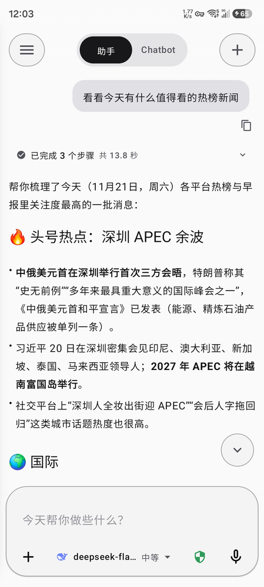
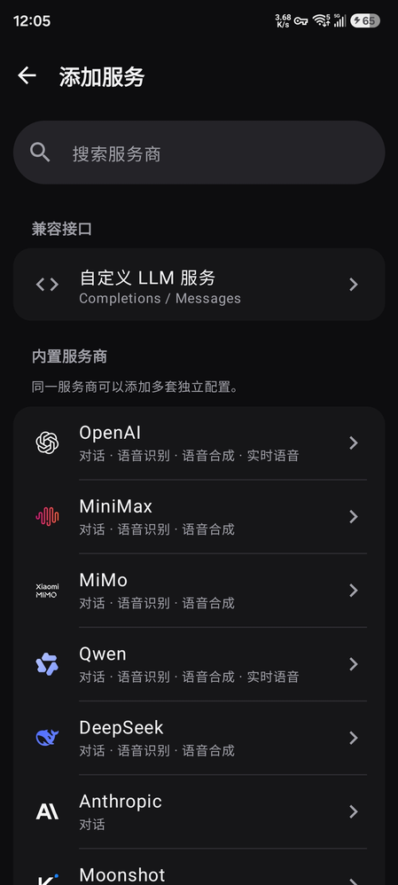
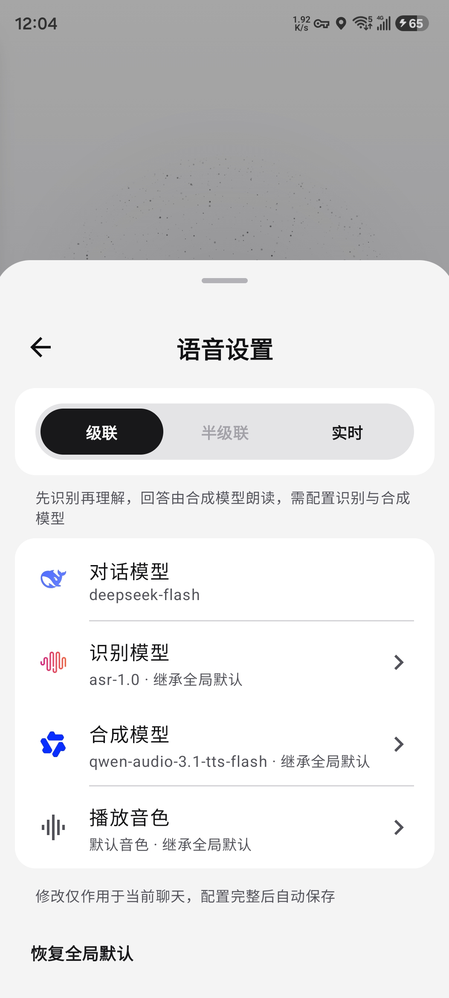
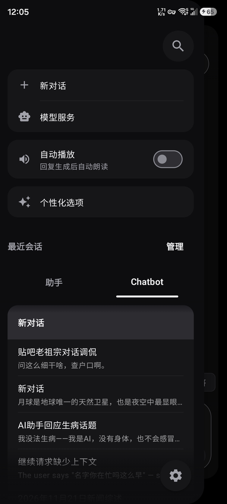
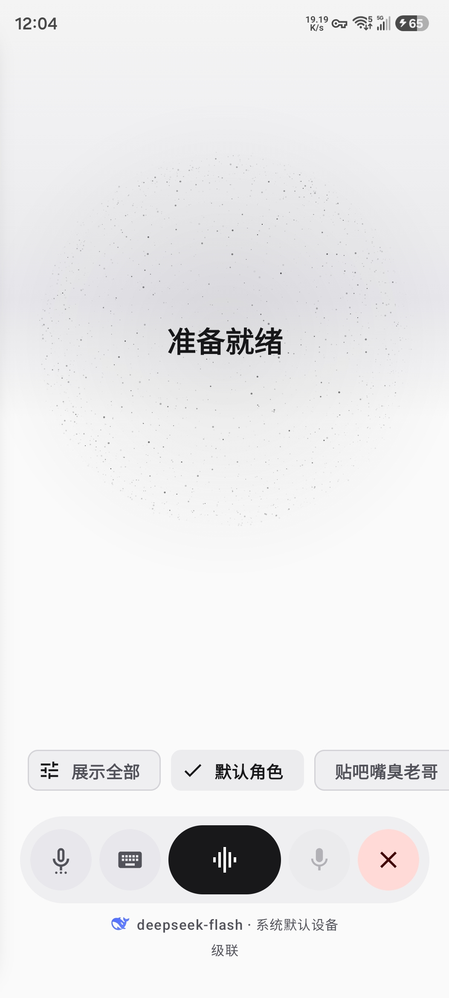
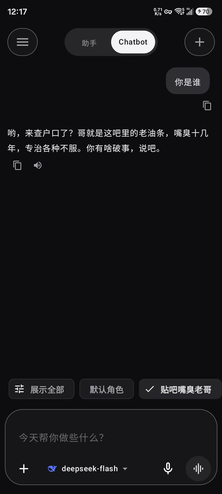
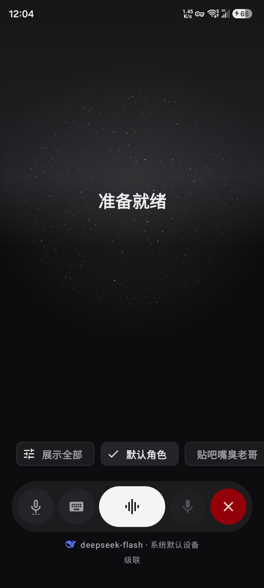
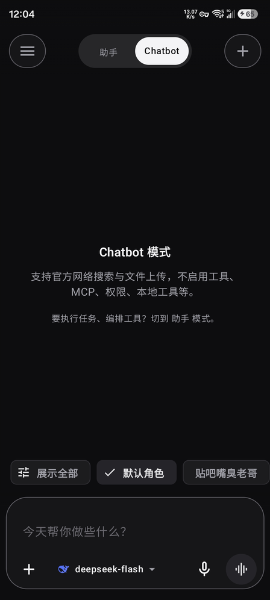

<picture>
  <source media="(prefers-color-scheme: dark)" srcset="doc/icon-dark.png" />
  
</picture>

# Gimi

**An Android AI assistant with your own API keys, phone tools, and extensible agents.**

Built as a fully native Android app with Material 3 and Jetpack Compose.

[English](README.md) · [简体中文](README.zh-CN.md)

## Features

- **Dual chat modes**: **Assistant** (full agent with phone tools, MCP, plugins, skills, and sandboxes) and **Chatbot** (lightweight conversation with web search and file interactions).
- **Voice calls**: three pipelines (Cascaded, Semi-cascaded, and Native Realtime) with client-side VAD turn detection and instant barge-in, hardware/software AEC with echo gating, background calls, and audio device routing.
- **File gateway**: upload documents via provider Files APIs with server-side reference reuse and per-conversation file management.
- **Phone tools**: calendars, alarms, media, volume, brightness, location, contacts, app management, and local file search.
- **Background tasks**: continue workflows in the background with system notifications for approvals and completion.
- **Personalization & memory**: per-conversation model and tool configuration, thinking depth controls, on-device memory, and Mem0 cloud memory.
- **Interactive cards**: asynchronous rendering of native interactive A2UI cards with client-side validation and inline retry.
- **Extensions**: official provider tools, MCP servers, remote A2A agents, APK plugins, skills, AppFunctions, Shizuku, a local Debian environment, and an E2B cloud sandbox.

<table>
<tr>
<td> Assistant chat</td>
<td> Add service</td>
<td> Voice settings</td>
<td> Conversation drawer</td>
</tr>
<tr>
<td> Voice call, cascaded</td>
<td> Chatbot persona</td>
<td> Voice call, dark mode</td>
<td> Chatbot mode, dark mode</td>
</tr>
</table>

## Getting started

Requires **Android 14+** and your own model API key.

1. Download a matching app APK from [Releases](https://github.com/pony-huang/Gimi/releases/latest).
2. In **Settings → Models**, add a built-in provider or a compatible endpoint, then configure its chat connection with your API key and models, test the connection, and enable the service.
3. In **Settings → Defaults**, select your default chat model, quick model (for titles and suggestions), and voice models (recognition, synthesis, and realtime).
4. Grant permissions as needed and start chatting. Toggle between **Assistant** and **Chatbot** modes using the mode switch in the top bar or drawer.

### Chat and voice workflows

- **Assistant mode**: Orchestrates full agent capabilities. In the composer's **Add to chat** panel, configure tools, attachments, and the global permission mode (*request approval* pauses sensitive tool calls for confirmation; *full approval* allows them automatically). Manage suggestions, A2UI cards, and tool loading in **Settings → Personalization**.
- **Chatbot mode**: A lightweight conversation mode. Pick or customize persona roles via the top chips, utilize official provider web search, and upload files. Tap the microphone icon beside the input box to start a voice call.
- **Voice calls and audio processing**: Voice calls bind to the current Chatbot conversation, sharing the same context and persona. Across all three modes, the client manages audio capture, client-side VAD turn detection, echo cancellation (AEC), and real-time interruption:
  - *Three pipelines*: Cascaded (ASR → LLM → TTS), Semi-cascaded (omni audio understanding → TTS), and Native Realtime (OpenAI & Qwen-Audio Realtime full-duplex audio).
  - *Client-side VAD turn detection & barge-in*: Client-side VAD evaluates speech probability per frame for turn segmentation; speaking immediately stops playback and cancels pending generation and synthesis.
  - *Echo cancellation & feedback suppression*: Hardware AEC preferred with software fallback; playback reference frames locked to the audio clock; persistent playback echo gating and acoustic tail guards prevent speaker playback from triggering echo loops.
  - *In-call controls*: Expand the bottom text dock to type or attach drafts (pauses microphone capture); background calls continue via foreground service and notification controls with audio routing and hang-up actions.

## Models and official tools

Presets:  **OpenAI** ·  **Anthropic** ·  **DeepSeek** ·  **Kimi** ·  **GLM** ·  **MiniMax** ·  **MiMo** ·  **Qwen**

Each model service is an independent named instance created from a provider template or custom endpoint. Multiple instances can share a provider while maintaining independent credentials, endpoints, connections, and model selections.

### Service connections

A model service provides dedicated capability connections:
- **Conversation**: standard LLM chat, agent execution, and quick-model tasks across supported providers.
- **Speech Recognition (ASR)**: dedicated transcription models or audio-understanding models.
- **Speech Synthesis (TTS)**: speech synthesis with model-specific voice selection.
- **Realtime**: full-duplex realtime voice call connections.

Voice capabilities are configured as connections of a model service: Qwen (Alibaba Cloud Bailian), OpenAI, MiniMax, MiMo, and DeepSeek provide recognition and synthesis; Kimi and GLM also serve synthesis and audio understanding over compatible audio channels.

Qwen (Alibaba Cloud Bailian via DashScope) covers the entire voice pipeline: `qwen-audio` models provide streaming recognition, whole-utterance transcription, `flash`/`plus` synthesis with dialect and multilingual voices, and full-duplex WebSocket Realtime sessions.

### Vendor file uploads

For model services supporting Files APIs (e.g. DeepSeek, Anthropic, OpenAI), configure **File upload** in service details:
- **Enabled**: documents are uploaded to the vendor and referenced by server-side handles, eliminating repeat uploads across turns and managed in the drawer.
- **Disabled**: only the local file path is passed as text for agent environment tools to read on demand.

### Official provider tools

Enable official tools under **Provider tools** in a service's details (**Settings → Models**), then select them in conversations:

| Provider | Official tools |
|---|---|
| DeepSeek | Web search and fetch |
| Anthropic | Web search |
| MiniMax | Web search, text-to-image, reference-image generation |
| GLM | Web search and webpage reading |
| Kimi | Search Basic / Pro and web fetch |

**Why no Gemini on mobile?** Gimi does not currently support Gemini on phones. The [Google Gen AI Kotlin SDK](https://github.com/googleapis/kotlin-genai#readme) supports Android, but its security guidance discourages embedding API keys or Google Cloud credentials in public mobile clients and recommends [Firebase AI Logic with App Check](https://firebase.google.com/docs/ai-logic) or a secure backend. Gimi has not adopted either architecture.

## Extensions

Configure optional capabilities in Settings:

| Extension | Purpose and requirements |
|---|---|
| **MCP** | Remote tools over Streamable HTTP; import `mcpServers` JSON or curl snippets. Supports bearer tokens and custom headers. |
| **A2A** | Delegate tasks to remote agents using an Agent URL and optional bearer token. |
| **Plugins** | Install separate APKs from Releases or the in-app subscription catalog; downloads are SHA-256 verified. |
| **Skills** | Install instructions and resources from a URL or local ZIP; run scripts in the local Debian environment or the E2B sandbox. |
| **Local environment** | Under **Settings → Environments**, the bundled Gimi Runtime companion APK (`:environment-runtime`) runs a local Debian (trixie) environment under a separate UID. Install or update the runtime component, edit environment variables, browse the directory tree, share persistent `HOME` across sessions (retaining logins like `ncm-cli`), and let the agent run shell commands, Python/JavaScript, and background jobs. |
| **E2B sandbox** | Configure an E2B API key for shell commands, Python/JavaScript, and files in an isolated cloud environment per conversation. |
| **AppFunctions** | Discover other apps' functions on supported Android 16+ devices; execution requires privileged system access. See the [execution guide](spec/en/appfunctions.md). |
| **Shizuku** | Configure it from **Settings → Shizuku**. Background app control requires Shizuku in ADB shell mode, an image-capable model, and overlay permission; text input and native element actions also need the Gimi Accessibility service. |

Available plugins:

| Plugin | Capabilities |
|---|---|
| Spotify | Search, playback, playlists, and library |
| Zhihu | Search, hot lists, synthesized answers, knowledge bases, and document tasks |
| V2EX | Nodes, topics, replies, notifications, and account information |
| Weibo | Trending searches, AI summaries, Super Topics, posts, and comments |
| Xiaohongshu | Sign-in, feeds, search, interactions, and image/video publishing through an on-device WebView |
| NetEase Cloud Music | Sign-in, search, lyrics, playlists, and authorized audio URLs; no playback control |

Some plugins require their own platform credentials and authorization. Third-party plugins can use the public [plugin API](plugin-api/).

## Privacy and permissions

Conversations, attachments, and settings are stored on the device. The developer operates no servers and collects no analytics or telemetry. Relevant content is sent to the model and other services you configure or enable; these services follow their own privacy policies.

Grant system permissions as needed and revoke them in Android settings. Document search across shared storage requires all-files access. See the [Privacy Policy](https://github.com/pony-huang/Gimi/wiki/Privacy-Policy).

## Contributing and documentation

Issues, feature suggestions, translations, and code contributions are welcome. Describe the use case and discuss substantial changes in an issue first.

- [Contributing](CONTRIBUTING.md)
- [Changelog](CHANGELOG.md)

## Thanks

- [GetStream/chat-ai-samples](https://github.com/GetStream/chat-ai-samples)
- [mikepenz/multiplatform-markdown-renderer](https://github.com/mikepenz/multiplatform-markdown-renderer)
- [google/adk-kotlin](https://github.com/google/adk-kotlin)
- [MediaPipe Text Embedder for Android](https://developers.google.com/edge/mediapipe/solutions/text/text_embedder/android)
- [xpzouying/xiaohongshu-mcp](https://github.com/xpzouying/xiaohongshu-mcp)
- [V2EX API](https://www.v2ex.com/go/v2exapi)
- [Zhihu Open Platform](https://developer.zhihu.com/docs)
- [NetEase Cloud Music ncm-cli](https://music.163.com/st/ncmcli)
- [RikkaApps/Shizuku](https://shizuku.rikka.app)
- [lobehub/lobe-icons](https://github.com/lobehub/lobe-icons)

## License

[Apache License 2.0](LICENSE)
