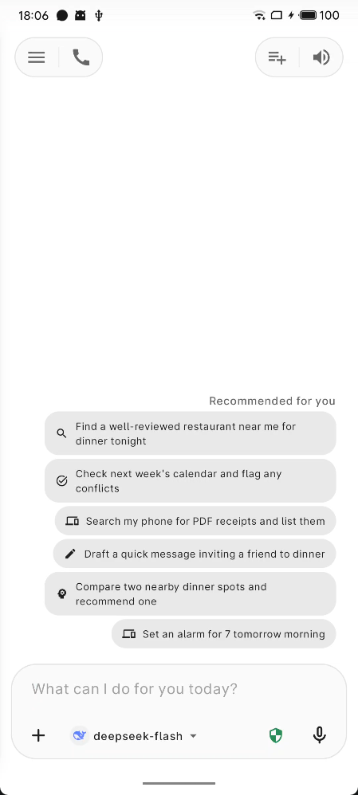
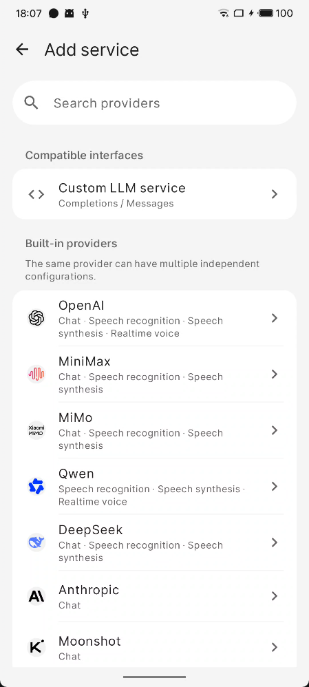
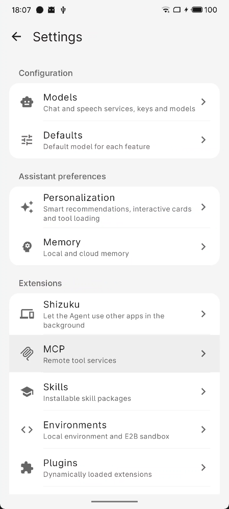
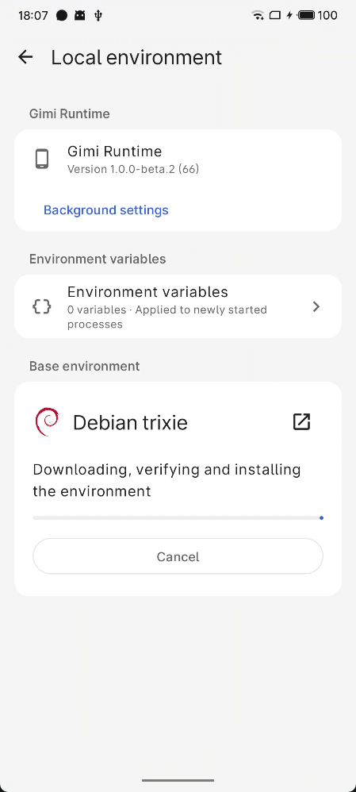
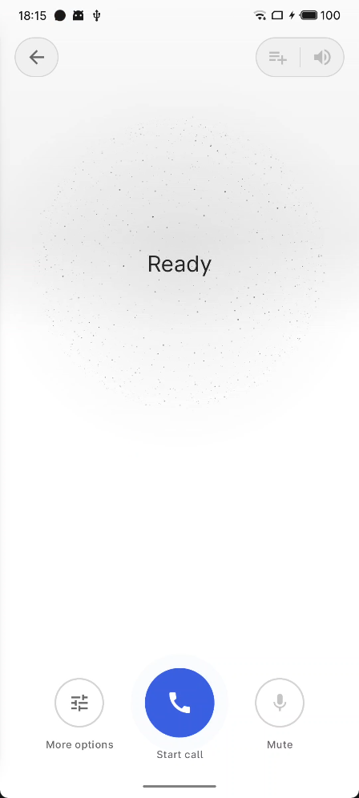
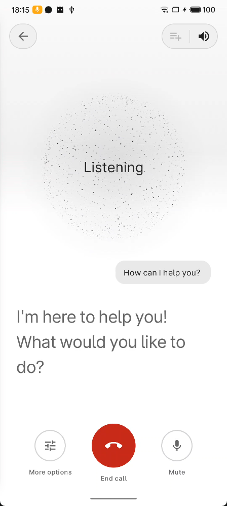
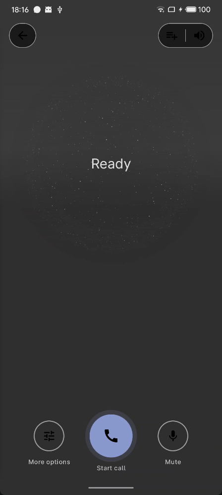
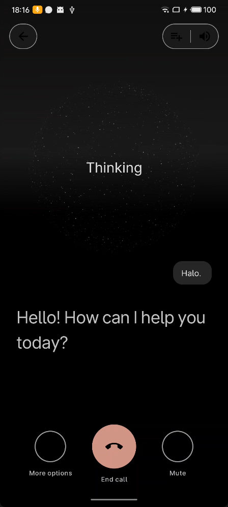

<picture>
  <source media="(prefers-color-scheme: dark)" srcset="doc/icon-dark.png" />
  
</picture>

# Gimi

**使用自己的 API Key，在 Android 上对话、调用手机工具并扩展 Agent 能力。**

使用 Jetpack Compose 构建的纯原生 Android 应用。

[English](README.md) · [简体中文](README.zh-CN.md)

## 主要能力

- **对话与语音**：流式回复，按模型能力支持图片、文档和音频附件，语音输入与回复朗读，以及原生 A2UI 交互卡片。语音通话提供四种模式，支持自动断句、随时打断，实时助手模式还可在通话中调用已授权工具。
- **手机工具**：日历、闹钟、媒体、音量、亮度、位置、联系人、应用，以及本地文件搜索与读取。
- **后台任务**：切到后台后继续运行，通过通知提示批准请求、补充输入和任务完成。
- **个性化**：按会话选择模型与工具，支持任务推荐、本地记忆和可选的 Mem0 记忆。
- **本地工作区**：保存和管理附件，支持以 JSONL 或 ZIP 导出会话。
- **能力扩展**：官方工具、MCP、远程 A2A Agent、APK 插件、技能、AppFunction、Shizuku、本地 Debian 运行环境和 E2B 云端沙盒。

<table>
<tr>
<td> 对话界面</td>
<td> 添加模型服务</td>
<td> 设置</td>
<td> 本地环境</td>
</tr>
<tr>
<td> 语音通话</td>
<td> 语音通话字幕</td>
<td> 语音通话深色模式</td>
<td> 实时助手深色模式</td>
</tr>
</table>

## 快速上手

需要 **Android 14+** 和自己的模型 API Key。

1. 从 [Releases](https://github.com/pony-huang/Gimi/releases/latest) 下载适配设备的应用 APK。
2. 在 **设置 → 模型服务** 添加内置服务商或兼容接口，填写 API 密钥、选择对话模型，检测连接并启用服务。
3. 在 **设置 → 默认模型** 选择对话模型和快速模型（用于标题与任务推荐）。
4. 按需授予权限，即可开始对话。在 **设置 → 个性化选项** 管理任务推荐、A2UI 卡片和工具加载方式。

使用语音时，在 **设置 → 模型服务** 的服务详情中配置识别、合成与实时连接；使用实时模式前，还需在 **设置 → 默认模型** 选定 Realtime 模型和音色。语音页的 **聊天模式** 面板提供「轻聊」（不写入聊天记录）、「助手」（完整助手与全部工具，文字保存到当前会话）、「实时」（原生全双工语音）和「实时助手」（在实时模式基础上，通话中可调用已授权的手机工具、MCP、插件、AppFunction 与本地环境或 E2B 沙盒工具）。实时语音通话不写入会话记录。

全局权限模式位于输入栏的 **添加到聊天** 面板：“请求批准”会暂停敏感工具调用并等待确认，“完全批准”则自动放行。

## 模型与官方工具

内置预设： **OpenAI** ·  **Anthropic** ·  **DeepSeek** ·  **Kimi** ·  **GLM** ·  **MiniMax** ·  **MiMo** ·  **千问 Qwen**

每个内置服务商包含一种或多种服务连接（对话、识别、合成或实时语音），同一服务商可添加多套独立配置，各自保存密钥与模型；千问为纯语音服务预设。

支持 **Completions**（OpenAI Chat Completions）和 **Messages**（Anthropic）两种接口协议。附件、推理和工具能力取决于所选模型与协议。

语音能力作为模型服务的连接配置：Qwen（阿里云百炼）、OpenAI、MiniMax、MiMo 和 DeepSeek（通过专用 `/v1/tools/asr`、`/v1/tools/tts` 端点）提供识别与合成；Kimi、GLM 也可通过 OpenAI 兼容音频接口提供合成与音频理解。OpenAI Realtime 与 Qwen-Audio Realtime 则支撑原生全双工实时模式。

千问（阿里云百炼，经 DashScope 平台接入）覆盖完整的语音链路。其 `qwen-audio` 模型提供流式识别、整段转写与 `flash`/`plus` 合成，每一代际与档位各带一套音色，包含普通话、方言与多语种音色。`qwen-audio` Realtime 模型建立原生全双工 WebSocket 会话，由服务端判断轮次并完成打断；其会话音色在 **设置 → 默认模型** 中选择，与合成音色互不通用。千问 Realtime 同时支持函数调用，因此实时助手模式在千问通话中也能调用已授权工具。

在 **设置 → 模型服务** 的服务详情「厂商工具」中启用官方工具，再在会话中选择使用：

| 服务商 | 官方工具 |
|---|---|
| DeepSeek | 联网搜索、网页抓取 |
| Anthropic | 联网搜索 |
| MiniMax | 联网搜索、文生图、参考图生成 |
| GLM | 联网搜索、网页读取 |
| Kimi | 联网搜索 Basic / Pro、网页抓取 |

**为什么手机端暂不支持 Gemini？** [Google Gen AI Kotlin SDK](https://github.com/googleapis/kotlin-genai#readme) 虽支持 Android，但其安全指南不建议在公开移动客户端中嵌入 API Key 或 Google Cloud 凭据，推荐使用 [Firebase AI Logic + App Check](https://firebase.google.com/docs/ai-logic) 或安全后端。Gimi 尚未采用上述架构，因此手机端目前不提供 Gemini 支持。

## 扩展能力

以下能力均可按需在设置中配置：

| 扩展 | 用途与条件 |
|---|---|
| **MCP** | 通过 Streamable HTTP 接入远程工具，可导入 `mcpServers` JSON 或 curl 片段，支持 Bearer Token 和自定义请求头。 |
| **A2A** | 填写 Agent 地址及可选的 Bearer Token，将任务委派给远程 Agent。 |
| **插件** | 安装 Releases 或应用内订阅目录中的独立 APK；下载后校验 SHA-256。 |
| **技能** | 从链接或本地 ZIP 安装说明与资源；可在本地 Debian 运行环境或 E2B 沙盒中运行脚本。 |
| **本地运行环境** | 在 **设置 → 运行环境** 中，随主 App 提供的 Gimi 运行组件以独立 UID 运行本地 Debian（trixie）环境；可安装或更新运行组件、编辑环境变量、浏览本地环境目录，并让 Agent 执行命令、Python/JavaScript 和后台任务。 |
| **E2B 沙盒** | 配置 E2B API Key，为每个会话提供独立的云端隔离环境，执行命令、Python/JavaScript 和文件操作。 |
| **AppFunction** | 在支持的 Android 16+ 设备上发现其他应用功能；执行需要系统特权，参见[执行指南](spec/zh/appfunctions.md)。 |
| **Shizuku** | 从 **设置 → Shizuku** 进入配置。后台操作其他应用，需 ADB shell 模式的 Shizuku、支持图片理解的模型和悬浮窗权限；文字输入与原生元素操作还需开启 Gimi 无障碍服务。 |

现有插件：

| 插件 | 能力 |
|---|---|
| Spotify | 搜索、播放、歌单和音乐库 |
| 知乎 | 搜索、热榜、直答、知识库和文档任务 |
| V2EX | 节点、主题、回复、通知和账号信息 |
| 微博 | 热搜、智搜摘要、超话、微博和评论 |
| 小红书 | 通过本机 WebView 登录、浏览、搜索、互动和发布图文/视频 |
| 网易云音乐 | 登录、搜索、歌词、歌单和授权音频链接；不含播放控制 |

部分插件需要单独配置平台凭据并授权。第三方可通过公开的[插件 API](plugin-api/) 开发扩展。

## 隐私与权限

对话、附件和配置保存在设备本地。开发者不运营服务器，不收集统计或遥测数据。调用模型及其他已配置或启用的服务时，会向对应服务发送必要内容，数据处理遵循其各自的隐私政策。

系统权限按需授予，可随时在 Android 设置中撤销；搜索共享存储中的文档需要“所有文件访问权限”。详见[隐私政策](https://github.com/pony-huang/Gimi/wiki/Privacy-Policy)。

## 贡献与文档

欢迎反馈问题、提出功能建议、改进翻译和提交代码。请说明具体使用场景，较大的调整先通过 Issue 讨论。

- [贡献指南](CONTRIBUTING.md)（英文）
- [更新日志](CHANGELOG.md)

## 致谢

- [GetStream/chat-ai-samples](https://github.com/GetStream/chat-ai-samples)
- [mikepenz/multiplatform-markdown-renderer](https://github.com/mikepenz/multiplatform-markdown-renderer)
- [google/adk-kotlin](https://github.com/google/adk-kotlin)
- [MediaPipe Text Embedder（Android）](https://developers.google.com/edge/mediapipe/solutions/text/text_embedder/android)
- [xpzouying/xiaohongshu-mcp](https://github.com/xpzouying/xiaohongshu-mcp)
- [V2EX API](https://www.v2ex.com/go/v2exapi)
- [知乎开放平台](https://developer.zhihu.com/docs)
- [网易云音乐 ncm-cli](https://music.163.com/st/ncmcli)
- [lobehub/lobe-icons](https://github.com/lobehub/lobe-icons)

## 开源协议

[Apache License 2.0](LICENSE)
