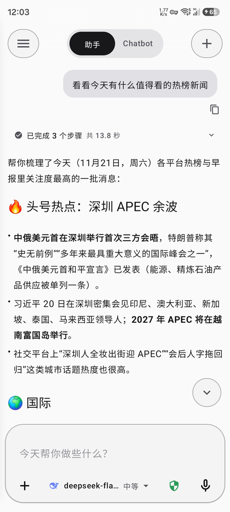
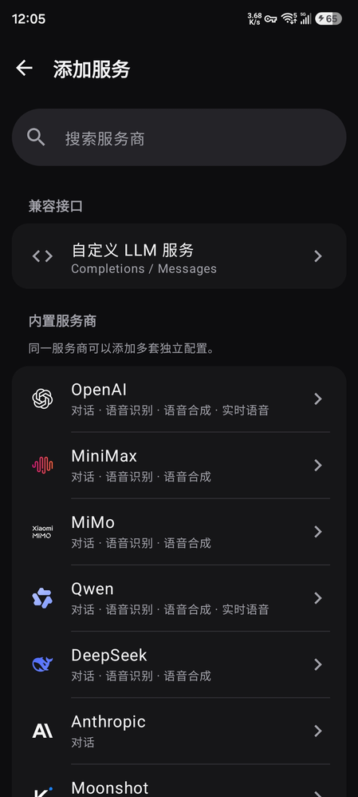
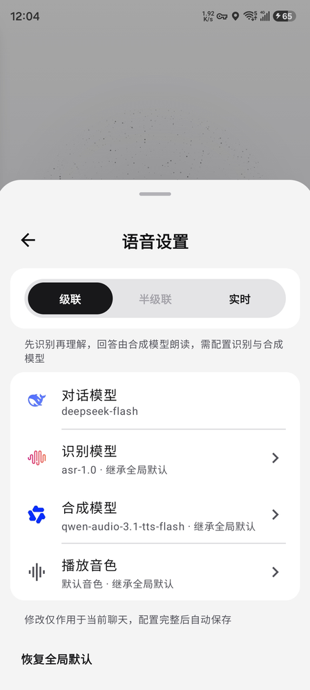
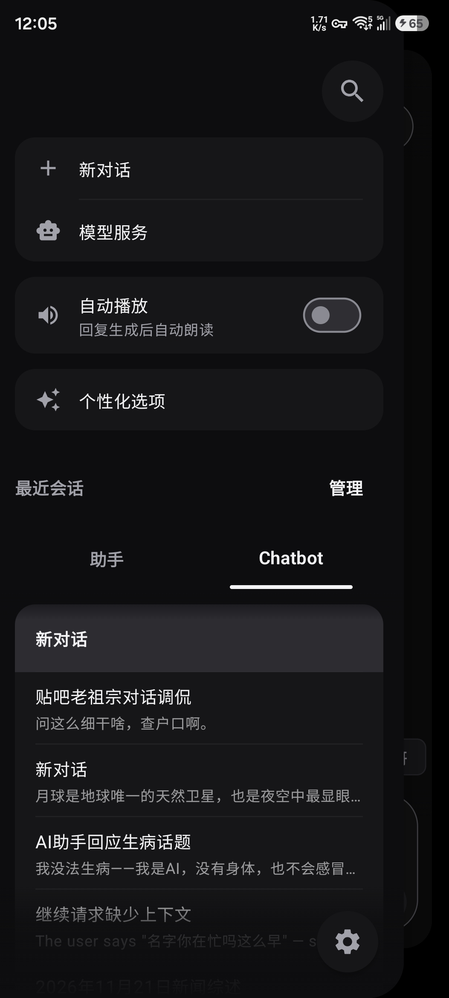
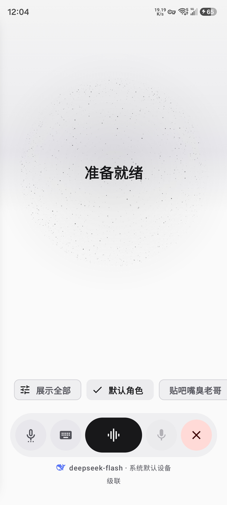
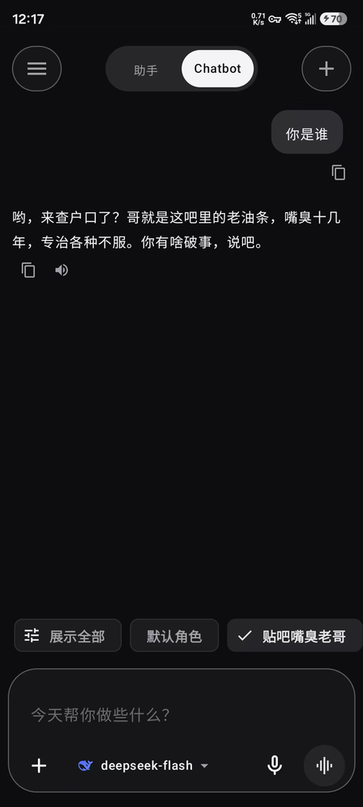
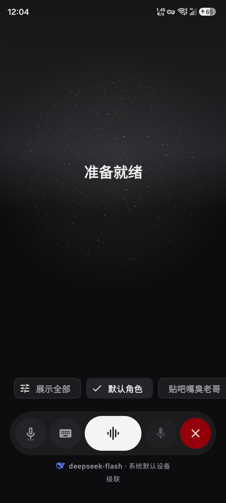
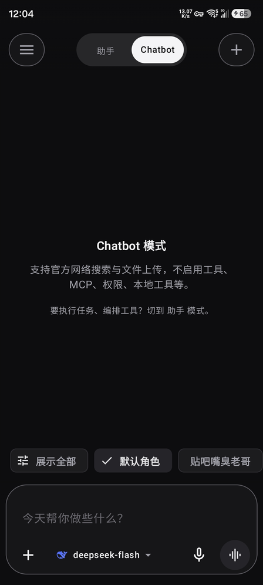

<picture>
  <source media="(prefers-color-scheme: dark)" srcset="doc/icon-dark.png" />
  
</picture>

# Gimi

**使用自己的 API Key，在 Android 上对话、调用手机工具并扩展 Agent 能力。**

使用 Material 3 与 Jetpack Compose 构建的纯原生 Android 应用。

[English](README.md) · [简体中文](README.zh-CN.md)

## 主要能力

- **双对话模式**：**助手**（支持系统工具、MCP、插件、技能与沙盒的全功能 Agent）与 **Chatbot**（专注日常交流、联网搜索与文件交互的轻量对话）。
- **语音通话**：提供级联、半级联与原生实时三种链路；端侧 VAD 智能断句与随时打断（Barge-in）、硬件/软件互斥回声消除（AEC）与回声门控防自激，支持后台通话与音频设备切换。
- **文件网关**：接入主流模型厂商文件接口，支持文档跨轮次引用免重复传输，并在会话中统一管理。
- **手机工具**：日历、闹钟、媒体、音量、亮度、位置、联系人、应用管理与本地文件搜索。
- **后台任务**：任务切入后台持续运行，通过系统通知推送授权与完成提醒。
- **个性化与记忆**：按会话独立配置模型与工具，支持思考深度调节、本地记忆与 Mem0 云端记忆。
- **交互卡片**：异步渲染原生交互式 A2UI 卡片，支持客户端校验与行内重试。
- **多维扩展**：官方工具、MCP、远程 A2A Agent、APK 插件、技能、AppFunction、Shizuku、本地 Debian 环境与 E2B 云端沙盒。

<table>
<tr>
<td> 助手对话</td>
<td> 添加模型服务</td>
<td> 语音设置</td>
<td> 会话抽屉</td>
</tr>
<tr>
<td> 语音通话（级联）</td>
<td> Chatbot 角色对话</td>
<td> 语音通话深色模式</td>
<td> Chatbot 模式深色</td>
</tr>
</table>

## 快速上手

需要 **Android 14+** 和自己的模型 API Key。

1. 从 [Releases](https://github.com/pony-huang/Gimi/releases/latest) 下载适配设备的应用 APK。
2. 在 **设置 → 模型服务** 添加内置服务商或兼容接口，填写 API 密钥、选择对话模型，检测连接并启用服务。
3. 在 **设置 → 默认模型** 选定默认对话模型、快速模型（用于标题生成与任务推荐）以及语音模型（识别、合成与实时语音）。
4. 按需授予权限，即可开始对话。通过顶栏或抽屉中的模式滑块在 **助手** 与 **Chatbot** 模式间自由切换。

### 对话与语音工作流

- **助手模式**：调度完整的 Agent 智能体能力。在输入栏的 **添加到聊天** 面板中按需配置工具、附件与全局权限模式（“请求批准”暂停敏感操作等待确认，“完全批准”自动放行）。在 **设置 → 个性化选项** 管理任务推荐、A2UI 卡片与工具加载策略。
- **Chatbot 模式**：轻量对话体验。通过顶部胶囊快速切换或自定义人设角色，使用厂商官方联网搜索并上传文件。点击输入框旁的麦克风图标可直接发起语音通话。
- **语音通话与音频处理**：语音通话与当前 Chatbot 会话绑定，文本与语音共享上下文和人设。客户端统一负责音频采集、端侧 VAD 断句、回声消除（AEC）与打断控制：
  - *三种链路*：级联模式（ASR → LLM → TTS）、半级联模式（全模态模型直接理解音频 → TTS 朗读）、原生实时模式（OpenAI Realtime 与阿里百炼 Qwen-Audio Realtime 全双工音频交互）。
  - *端侧 VAD 断句与打断（Barge-in）*：基于端侧 VAD 逐帧检测语音概率，识别停顿断句；播报期间只要用户开口说话，立即停止播放并取消未完成的生成与合成任务。
  - *回声消除与防自激抑制*：优先使用硬件 AEC，未适配时回落软件消除器；参考信号对齐播放时钟；通过常驻播放回声门控与声学尾音防护，避免扬声器播放被录入产生回声自激。
  - *通话交互与控制*：支持随时展开文字输入抽屉输入文本或暂存草稿（自动暂停收音）；切到后台后通过前台服务与通知栏控制保持运行，支持静音、音频输出切换与挂断。

## 模型与官方工具

内置预设： **OpenAI** ·  **Anthropic** ·  **DeepSeek** ·  **Kimi** ·  **GLM** ·  **MiniMax** ·  **MiMo** ·  **千问 Qwen**

每个模型服务均为基于服务商模板或自定义端点创建的独立命名实例。同一服务商可添加多套独立配置，各自保存独立的密钥、端点、连接与模型。

### 服务连接

每个模型服务支持配置多种能力连接：
- **对话连接**：负责日常对话、智能体执行与快速模型任务，支持主流模型接口。
- **语音识别（ASR）**：专用语音转写模型或音频理解模型。
- **语音合成（TTS）**：语音合成播报，可按模型配置专属音色。
- **实时语音（Realtime）**：全双工实时音频通话连接。

语音能力作为模型服务的连接配置：Qwen（阿里云百炼）、OpenAI、MiniMax、MiMo 和 DeepSeek 提供识别与合成；Kimi、GLM 也可通过音频接口提供合成与音频理解。

千问（阿里云百炼，经 DashScope 平台接入）覆盖完整的语音链路：`qwen-audio` 模型提供流式识别、整段转写与 `flash`/`plus` 合成（包含方言与多语种音色），其实时模型支持全双工 WebSocket 会话与服务端智能打断。

### 厂商文件上传

对于支持文件接口的模型服务（如 DeepSeek、Anthropic、OpenAI），可在服务详情中开启**文件上传**：
- **开启**：文档上传至服务商后以服务端引用传递，多轮对话无需重复传输，支持在抽屉中集中管理与删除。
- **关闭**：仅向模型传递本地文件路径文本，由 Agent 环境工具按需读取。

### 官方服务商工具

在 **设置 → 模型服务** 的服务详情「厂商工具」中启用官方工具，再在会话中选择使用：

| 服务商 | 官方工具 |
|---|---|
| DeepSeek | 联网搜索、网页抓取 |
| Anthropic | 联网搜索 |
| MiniMax | 联网搜索、文生图、参考图生成 |
| GLM | 联网搜索、网页读取 |
| Kimi | 联网搜索 Basic / Pro、网页抓取 |

**为什么手机端暂不支持 Gemini？** [Google Gen AI Kotlin SDK](https://github.com/googleapis/kotlin-genai#readme) 虽支持 Android，但其安全指南不建议在公开移动客户端中嵌入 API Key 或 Google Cloud 凭据，推荐使用 [Firebase AI Logic + App Check](https://firebase.google.com/docs/ai-logic) 或安全后端。Gimi 尚未采用上述架构，因此手机端目前不提供 Gemini 支持。

## 扩展能力

以下能力均可按需在设置中配置：

| 扩展 | 用途与条件 |
|---|---|
| **MCP** | 通过 Streamable HTTP 接入远程工具，可导入 `mcpServers` JSON 或 curl 片段，支持 Bearer Token 和自定义请求头。 |
| **A2A** | 填写 Agent 地址及可选的 Bearer Token，将任务委派给远程 Agent。 |
| **插件** | 安装 Releases 或应用内订阅目录中的独立 APK；下载后校验 SHA-256。 |
| **技能** | 从链接或本地 ZIP 安装说明与资源；可在本地 Debian 运行环境或 E2B 沙盒中运行脚本。 |
| **本地运行环境** | 在 **设置 → 运行环境** 中，随主 App 提供的 Gimi 运行组件（`:environment-runtime`）以独立 UID 运行本地 Debian（trixie）环境；可安装或更新运行组件、编辑环境变量、浏览本地环境目录、跨会话共享持久化 `HOME` 目录（持久化 `ncm-cli` 等命令行工具登录态），并让 Agent 执行命令、Python/JavaScript 和后台任务。 |
| **E2B 沙盒** | 配置 E2B API Key，为每个会话提供独立的云端隔离环境，执行命令、Python/JavaScript 和文件操作。 |
| **AppFunction** | 在支持的 Android 16+ 设备上发现其他应用功能；执行需要系统特权，参见[执行指南](spec/zh/appfunctions.md)。 |
| **Shizuku** | 从 **设置 → Shizuku** 进入配置。后台操作其他应用，需 ADB shell 模式的 Shizuku、支持图片理解的模型和悬浮窗权限；文字输入与原生元素操作还需开启 Gimi 无障碍服务。 |

现有插件：

| 插件 | 能力 |
|---|---|
| Spotify | 搜索、播放、歌单和音乐库 |
| 知乎 | 搜索、热榜、直答、知识库和文档任务 |
| V2EX | 节点、主题、回复、通知和账号信息 |
| 微博 | 热搜、智搜摘要、超话、微博和评论 |
| 小红书 | 通过本机 WebView 登录、浏览、搜索、互动和发布图文/视频 |
| 网易云音乐 | 登录、搜索、歌词、歌单和授权音频链接；不含播放控制 |

部分插件需要单独配置平台凭据并授权。第三方可通过公开的[插件 API](plugin-api/) 开发扩展。

## 隐私与权限

对话、附件和配置保存在设备本地。开发者不运营服务器，不收集统计或遥测数据。调用模型及其他已配置或启用的服务时，会向对应服务发送必要内容，数据处理遵循其各自的隐私政策。

系统权限按需授予，可随时在 Android 设置中撤销；搜索共享存储中的文档需要“所有文件访问权限”。详见[隐私政策](https://github.com/pony-huang/Gimi/wiki/Privacy-Policy)。

## 贡献与文档

欢迎反馈问题、提出功能建议、改进翻译和提交代码。请说明具体使用场景，较大的调整先通过 Issue 讨论。

- [贡献指南](CONTRIBUTING.md)
- [更新日志](CHANGELOG.md)

## 致谢

- [GetStream/chat-ai-samples](https://github.com/GetStream/chat-ai-samples)
- [mikepenz/multiplatform-markdown-renderer](https://github.com/mikepenz/multiplatform-markdown-renderer)
- [google/adk-kotlin](https://github.com/google/adk-kotlin)
- [MediaPipe Text Embedder（Android）](https://developers.google.com/edge/mediapipe/solutions/text/text_embedder/android)
- [xpzouying/xiaohongshu-mcp](https://github.com/xpzouying/xiaohongshu-mcp)
- [V2EX API](https://www.v2ex.com/go/v2exapi)
- [知乎开放平台](https://developer.zhihu.com/docs)
- [网易云音乐 ncm-cli](https://music.163.com/st/ncmcli)
- [RikkaApps/Shizuku](https://shizuku.rikka.app)
- [lobehub/lobe-icons](https://github.com/lobehub/lobe-icons)

## 开源协议

[Apache License 2.0](LICENSE)
